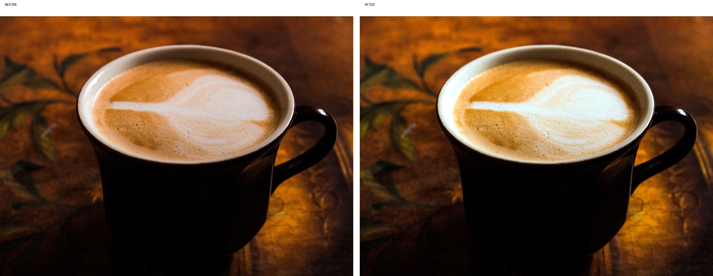
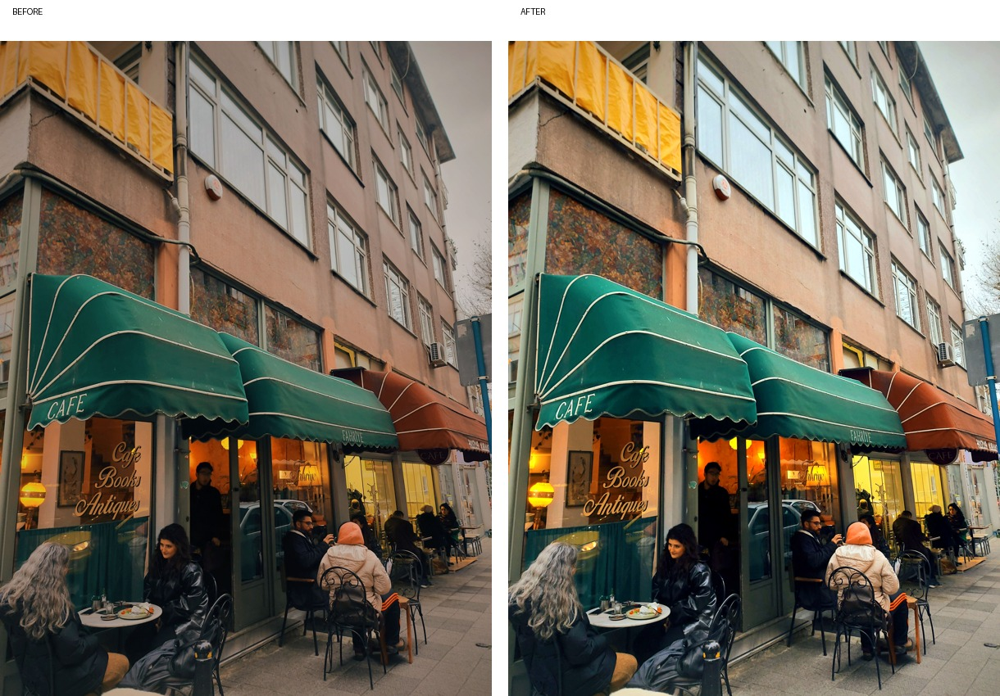
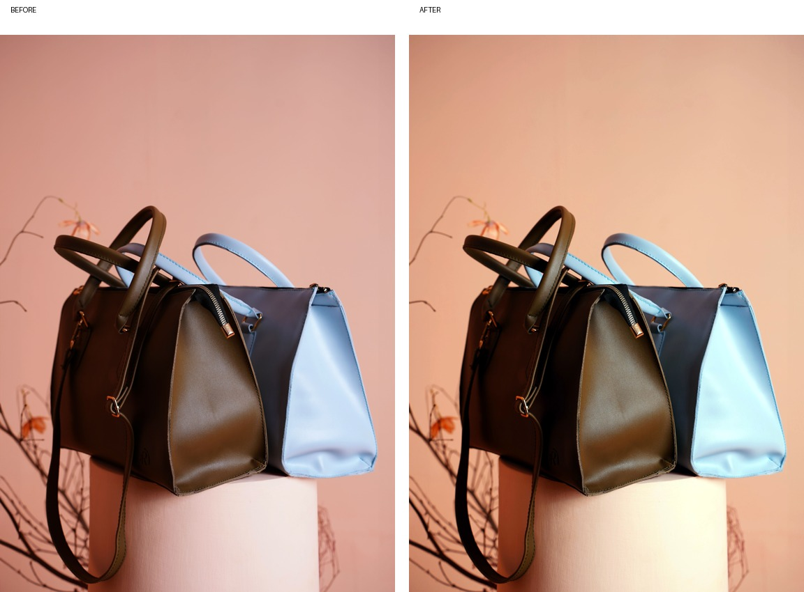

# Social Media Photo Pipeline (Before/After Retouching)

A one-command Python pipeline that batch-processes photos for social media.

**What it does**
1. Fixes orientation (EXIF) and applies light color correction (auto-contrast, color, sharpness)
2. Optionally removes the background (`rembg`) and places the subject on a brand-color backdrop
3. Exports every photo as an Instagram post (4:5), square (1:1) and story (9:16)
4. Builds a labeled before/after image for each photo

**Demo run:** 9 photos (3 food, 3 places, 3 products) became 27 social-ready exports and 9 before/after comparisons in a single run.

## Before / After

| Food | Place | Product |
|---|---|---|
|  |  |  |

More in [`results/before_after`](results/before_after) and the exports in [`results/exports`](results/exports).

## Run it
```bash
pip install pillow
pip install "rembg[cpu]"   # only for --remove-bg
python photo_pipeline.py --input photos --output results
python photo_pipeline.py --input photos --output results --remove-bg --bg "#F2E3CF"
```

## Tools
Python, Pillow, rembg (optional)
